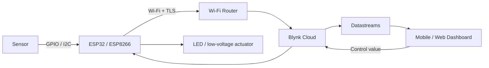

# IoT + Blynk Learning Kit

A hands-on learning path for Internet of Things (IoT) systems using ESP32/ESP8266, Blynk IoT, sensors, firmware, and network topologies.

## Start here

1. Read [the learning roadmap](docs/00_learning_roadmap.md).
2. Set up Arduino IDE with [the toolchain guide](docs/01_toolchain_setup.md).
3. Complete [Lab 1: remote LED control](labs/01_led_remote_control.md).
4. Configure your Blynk template and widgets using [the Blynk guide](docs/02_blynk_setup.md).
5. Add sensor telemetry with [Lab 2](labs/02_sensor_telemetry.md).

## What's included

- **docs/** — roadmap, hardware/toolchain setup, Blynk setup, networking, firmware patterns, debugging, security, and glossary.
- **diagrams/** — Mermaid source diagrams for system topology, Blynk data flow, network topologies, wiring, and failure handling.
- **firmware/** — starter Arduino sketches for ESP32 remote LED control, ESP32 DHT11 telemetry + LED control, and ESP8266 LED control.
- **labs/** — guided practical labs and pass criteria.
- **checklists/** — hardware preflight and Blynk integration checklists.

## Architecture at a glance

Editable topology sources are in [diagrams/](diagrams/).

## Starter firmware

| Example | Sketch | Blynk datastreams |
|---|---|---|
| ESP32 remote LED | [esp32_blynk_led.ino](firmware/esp32_blynk_led/esp32_blynk_led.ino) | V0: 0/1 switch |
| ESP32 DHT11 + LED | [esp32_blynk_dht11.ino](firmware/esp32_blynk_dht11/esp32_blynk_dht11.ino) | V0: temperature, V1: humidity, V2: LED |
| ESP8266 remote LED | [esp8266_blynk_led.ino](firmware/esp8266_blynk_led/esp8266_blynk_led.ino) | V0: 0/1 switch |

All sketches contain credential placeholders. Create a Blynk template/device, then fill in your template ID/name, device auth token, and Wi-Fi credentials locally. **Never commit real tokens or Wi-Fi passwords.**

## Official references

- [Blynk Documentation](https://docs.blynk.io/)
- [Blynk device templates](https://docs.blynk.io/en/concepts/device-template)
- [Blynk datastreams](https://docs.blynk.io/en/blynk.console/templates/datastreams)
- [Arduino IDE](https://www.arduino.cc/en/software)
- [Arduino-ESP32 documentation](https://docs.espressif.com/projects/arduino-esp32/en/latest/)
- [ESP8266 Arduino Core](https://arduino-esp8266.readthedocs.io/)
- [MQTT](https://mqtt.org/)
- [Mermaid diagrams](https://mermaid.js.org/)

## Safety and security

- ESP32 GPIO is 3.3 V logic and is not 5 V tolerant.
- Use current-limiting resistors for LEDs and proper driver circuits for relays, motors, pumps, and other loads.
- Do not prototype mains-voltage circuits on a breadboard.
- Keep critical safe behavior local; cloud connectivity may be delayed or unavailable.
- Validate remote commands and define a safe startup state.
- Treat device tokens and Wi-Fi credentials as secrets.

## License

This project is released under the MIT License. See [LICENSE](LICENSE).

## Learning path

Fundamentals → standalone sensors → Wi-Fi → Blynk LED control → telemetry → two-way control → reliability/security → capstone project.
